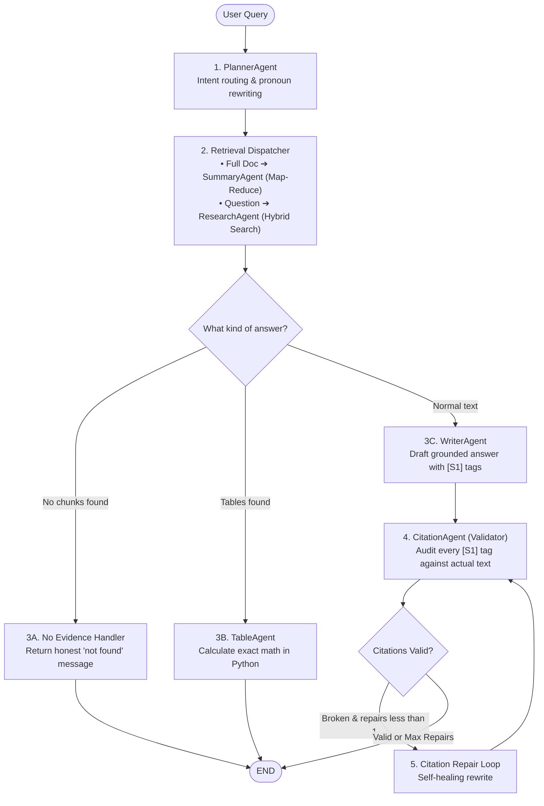

# Multi-Agent RAG System 🧠📚

> **A production-grade, supervised multi-agent Retrieval-Augmented Generation (RAG) platform with LangGraph orchestration, Section-Aware Hierarchical Map-Reduce, deterministic table calculations, and zero-hallucination page citations.**

[](https://www.python.org/)
[](https://streamlit.io/)
[](https://langchain-ai.github.io/langgraph/)
[](https://www.trychroma.com/)
[](LICENSE)

---

## 📌 Overview

This platform is engineered to answer complex questions and synthesize comprehensive briefings over massive document corpora (such as 100–400+ page municipal bylaws, regulatory codes, legal statutes, and technical theses). 

Instead of relying on a single monolithic prompt (which suffers from hallucinations, cognitive drift, and arithmetic errors), this system coordinates **specialized autonomous agents** through a **supervised LangGraph state machine**. Every agent operates as a decoupled worker reading from and mutating a shared blackboard state (**`WorkflowState`**).

---

## 🚀 Key Architectural Capabilities

### 1. 🤖 Supervised Multi-Agent Orchestration (LangGraph)
* **`PlannerAgent`**: Decouples incoming queries into exact execution plans. Uses regex and semantic intent detection to route queries (`full_doc`, `section`, or `standard`), and resolves follow-up pronouns (*"What about for residential buildings?"*) using conversational history.
* **`ResearchAgent`**: Autonomous exploration specialist coordinating dense vector search and sparse BM25 keyword matching with a CrossEncoder reranker. Includes an **`EvidenceSufficiencyAnalyst`** for self-reflective search expansion.
* **`DocumentSummaryAgent`**: Solves the "Lost in the Middle" problem for 100–400+ page documents using **Section-Aware Hierarchical Map-Reduce** to digest 100% of chunks without hitting rate limits.
* **`TableAgent`**: Extracts Markdown tables and executes deterministic Python/Decimal arithmetic (`sum`, `average`, `min`, `max`, `count`) and cell lookups with **0% LLM guesswork**.
* **`WriterAgent`**: Drafts strictly grounded answers with token-by-token streaming and explicit citation brackets (`[S1]`, `[S2]`).
* **`CitationAgent`**: Audits drafts against retrieved chunks and executes a bounded **self-healing repair loop** (`repair_count < 1`) with verbatim excerpt fallback to guarantee zero citation hallucinations.

---

### 2. 📑 Whole-Document Summarization (Hierarchical Map-Reduce)
Standard Top-K RAG only grabs 5–10 chunks (<2% of a 400-page document). This system solves whole-document synthesis:
1. **Deterministic Partitioning:** Algorithmic clustering (0-LLM) partitions 100% of document chunks into 3–4 chronological macro volume clusters.
2. **Concurrent Map Phase:** Runs parallel LLM workers using Python's `ThreadPoolExecutor` to distill each volume into a high-density micro-digest.
3. **Executive Reduce Phase:** Synthesizes the volume digests into an authoritative 5-part Executive Briefing.
4. **Rate-Limit Safe:** Capping clusters to 3–4 guarantees total API calls remain well below Google Gemini's **15 Requests-Per-Minute (RPM)** free tier limit.
5. **Sub-10ms Caching:** Computed document summaries are cached in-memory for instant repeat lookups.

---

### 3. 🗄️ 3-Tier Memory Architecture
Memory is partitioned into three distinct layers to ensure session safety and zero data bleeding:
* **Tier 1: In-Flight State (`WorkflowState`)** — Ephemeral blackboard dictionary passed between graph nodes during a single request turn.
* **Tier 2: Conversational Memory (`MemorySaver`)** — State-isolated thread persistence keyed strictly by `session_id`. Resolves multi-turn follow-ups without bleeding between users.
* **Tier 3: Permanent Knowledge Base (ChromaDB + SQLite)** — On-disk dense vector embeddings (`sentence-transformers/all-MiniLM-L6-v2`) and sparse BM25 indices.

---

### 4. 🔬 Hybrid Retrieval & CrossEncoder Reranking
* **Dense Semantic Search:** Captures conceptual meaning via ChromaDB.
* **Sparse Lexical Search:** Exact token and clause number matching via SQLite FTS5 (BM25).
* **Reciprocal Rank Fusion (RRF):** Fuses dense vector and BM25 candidate ranks.
* **Cross-Encoder Reranker:** Re-scores candidate pairs using `cross-encoder/ms-marco-MiniLM-L-6-v2` in $<0.15$ seconds to surface the truest context.

---

### 5. 🛡️ High-Availability Dual LLM Provider
* **Primary LLM:** Google AI Studio (`gemini-flash-lite-latest` or `gemini-1.5-flash`).
* **Fallback LLM:** Groq (`openai/gpt-oss-120b` or `llama-3.3-70b-versatile`).
* **60-Second Cooldown Router:** If the primary provider triggers an HTTP `429 RESOURCE_EXHAUSTED` rate limit, the orchestrator automatically routes traffic to Groq for 60 seconds without dropping active sessions.

---

## 🏛️ System Architecture Flow



> 💡 **Visual Architecture Diagrams**:
> - Open [`architecture_diagram.svg`](architecture_diagram.svg) in any web browser for a full standalone vector diagram.
> - Run `python generate_diagram.py` to generate a 300 DPI high-res [`architecture_diagram.png`](architecture_diagram.png).
> - Detailed specifications are available in [`architecture_plan.md`](architecture_plan.md).

---

## 🛠️ Agent Tool Registry

Every agent is equipped with isolated tools and routines:

| Agent | Dedicated Tools & Routines | Operational Task |
| :--- | :--- | :--- |
| **`PlannerAgent`** | `plan()`, `reformulate_query()`, `plan_with_llm()` | Syntactic regex routing (`full_doc`, `section`, `standard`) and multi-turn pronoun resolution. |
| **`ResearchAgent`** | `search_documents()`, `get_page_range()`, `get_section()`, `get_document_outline()` | Hybrid search (ChromaDB + BM25 + RRF + CrossEncoder) and section extraction. |
| **`SummaryAgent`** | `partition_chunks()`, `map_cluster()`, `reduce_digests()` | Section-Aware Hierarchical Map-Reduce with parallel thread execution. |
| **`TableAgent`** | `calculate_table_aggregation()`, `lookup_table_cell()` | Exact Decimal arithmetic (sum, average, min, max, count) and cell lookups. |
| **`WriterAgent`** | `build_context_and_evidence()`, `write_answer_stream()` | Numbered context preparation and real-time streaming answer synthesis. |
| **`CitationAgent`** | `verify_citations()`, `repair_citations()`, `format_source_references()`, `extract_cited_fallback()` | Two-tier citation validation, bounded repair loop, and bibliography formatting. |

---

## 📂 Project Structure

```text
rag_chatbot_multiagent/
├── data/                       # Document storage directory
│   ├── pdf/                    # Uploaded and indexed PDF files
│   └── vector_store/           # Persistent ChromaDB collections & BM25 indices
├── src/
│   ├── agents/                 # Autonomous agent specialists
│   │   ├── contracts.py        # Typed contracts: WorkflowState, EvidenceChunk, PlannerOutput
│   │   ├── planner_agent.py    # Query intent routing & referential reformulation
│   │   ├── research_agent.py   # Hybrid retrieval agent & EvidenceSufficiencyAnalyst
│   │   ├── summary_agent.py    # Section-Aware Hierarchical Map-Reduce summarizer
│   │   ├── table_agent.py      # Deterministic Markdown table math calculator
│   │   ├── writer_agent.py     # Grounded drafting agent & token streaming
│   │   ├── citation_agent.py   # Citation verification & self-healing repair
│   │   └── tools/              # Decoupled agent tool definitions
│   │       ├── research_tools.py # search_documents, get_page_range, get_section
│   │       ├── table_tools.py    # calculate_table_aggregation, lookup_table_cell
│   │       └── citation_tools.py # verify_citations, format_source_references
│   ├── orchestration/
│   │   └── graph.py            # LangGraph StateGraph, conditional edges, MemorySaver checkpointer
│   ├── retrieval/              # Data ingestion and search infrastructure
│   │   ├── chroma_vectorstore.py # Persistent ChromaDB collection management
│   │   ├── hybrid_search.py    # BM25 + Dense RRF fusion & CrossEncoder reranker
│   │   ├── data_loader.py      # Multi-format parsing (PDF, DOCX, CSV, TXT)
│   │   └── embeddings.py       # SentenceTransformer embedding models
│   ├── services/               # Deterministic business services
│   │   ├── table_service.py    # Pandas/Python tabular calculation engine
│   │   └── citation_service.py # Citation normalization, audit, and excerpt fallback
│   ├── chat_service.py         # Session management, token streamer, 60s cooldown router
│   └── rag_pipeline.py         # Clean facade connecting UI to the graph
├── tests/                      # Automated test suite (Pytest)
│   ├── test_hierarchical_summary.py
│   └── test_session_isolation_and_agent_eval.py
├── app.py                      # Streamlit interactive web application
├── architecture_plan.md        # Authoritative system architectural specification
├── architecture_diagram.svg    # Standalone vector architecture diagram
├── generate_diagram.py         # 300 DPI PNG diagram generator
├── requirements.txt            # Python dependencies
└── README.md                   # This documentation
```

---

## 🚀 Getting Started

### 1. Prerequisites
* Python 3.10, 3.11, or 3.12
* Git
* A free [Google AI Studio API Key](https://aistudio.google.com/) and/or [Groq API Key](https://console.groq.com/)

### 2. Clone and Setup Environment
```bash
# Clone the repository
git clone https://github.com/your-username/rag_chatbot_multiagent.git
cd rag_chatbot_multiagent

# Create and activate virtual environment
# On Windows (PowerShell):
python -m venv venv
.\venv\Scripts\Activate.ps1

# On Linux / macOS:
python3 -m venv venv
source venv/bin/activate

# Install dependencies
pip install -r requirements.txt
```

### 3. Configure API Credentials
Create a `.env` file in the project root:
```env
# Primary LLM (Google AI Studio)
GEMINI_API_KEY=your_gemini_api_key_here

# Fallback LLM (Groq)
GROQ_API_KEY=your_groq_api_key_here
```

### 4. Launch the Application
```bash
streamlit run app.py
```

* **Upload:** Ingest multi-hundred page PDFs, Word docs, CSVs, or text files via the sidebar.
* **Summarization:** Type `"summarise this document"` or `"summarise the whole document"` to trigger the Hierarchical Map-Reduce pipeline.
* **Table Questions:** Ask mathematical questions on tables (e.g. *"What is the total sum of water requirements across all zones?"*) to trigger deterministic Python math.
* **Citations:** Click the collapsible **"📎 Sources"** toggle beneath any answer to inspect the exact pages and excerpts used.

---

## 🧪 Running Automated Tests

Run the complete test suite with Pytest:
```bash
pytest tests/ -v
```

All unit and integration tests verify:
- Intent routing for UK/US spellings (`summarise` vs `summarize`).
- Multi-session isolation without data bleeding.
- Adaptive Map-Reduce scaling for 400+ page documents.
- Bounded citation repair loops and table execution.

---

## 📊 Technical Specifications Summary

| Component | Engine / Technology | Purpose |
| :--- | :--- | :--- |
| **Orchestrator** | **LangGraph** (`StateGraph`) | Supervised blackboard workflow with bounded transitions. |
| **State Contract** | **`WorkflowState`** (`TypedDict`) | In-flight typed dictionary decoupling all agents. |
| **Session Memory** | **`MemorySaver`** | Session-isolated multi-turn conversation checkpointer. |
| **Dense Embeddings**| `all-MiniLM-L6-v2` | High-efficiency 384-dimensional semantic dense vectors. |
| **Sparse Retrieval**| SQLite FTS5 (BM25) | Exact token matching for statutory sections and rules. |
| **Reranker** | `ms-marco-MiniLM-L-6-v2` | Deep cross-encoder candidate rescoring ($<0.15$s). |
| **Primary LLM** | Google Gemini Flash Lite | 1,000,000 token context window, fast streaming. |
| **Fallback LLM** | Groq Llama 3 / GPT-OSS | Automatic 60s cooldown failover for rate-limit protection. |
| **Tabular Math** | Python `Decimal` / Pandas | 100% deterministic arithmetic on Markdown tables. |

---

## 📜 License

This project is licensed under the [MIT License](LICENSE).
