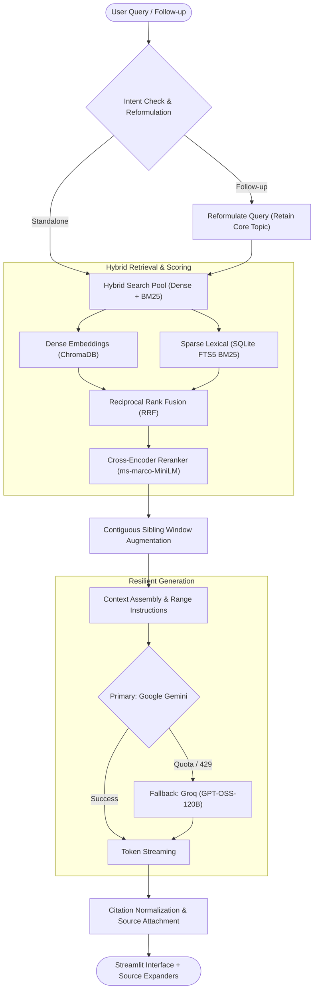

# CorpusRAG 🧠📚

> **A production-grade, enterprise Retrieval-Augmented Generation (RAG) system with Hybrid Search, Cross-Encoder Reranking, Contiguous Window Expansion, and Verifiable Page-Level Citations.**

[](https://www.python.org/)
[](https://streamlit.io/)
[](https://www.trychroma.com/)
[](https://www.langchain.com/)
[](LICENSE)

---

## 📌 Overview

**CorpusRAG** is engineered to perform high-precision question answering over large, complex document corpora (such as multi-hundred-page regulatory codes, municipal bylaws, legal acts, and financial reports). Unlike naive RAG pipelines that suffer from chunk boundary fragmentation, hallucinated citations, or context drift, CorpusRAG incorporates an end-to-end multi-stage pipeline designed for **accuracy, continuity, and zero-hallucination grounding**.

---

## 🚀 Key Highlights

* **🤖 Supervised Multi-Agent Orchestration (LangGraph):**
  * **Query Planner Agent:** Classifies intent (full document, chapter/section, standard QA), resolves conversational follow-ups, and expands legal exclusions.
  * **Retrieval Specialist:** Coordinates hybrid dense and BM25 sparse search with Cross-Encoder reranking.
  * **Deterministic Table Analyst:** Computes exact cell lookups and decimal-safe aggregations (`sum`, `average`, `min`, `max`, `count`) without LLM drift.
  * **Answer Writer Agent:** Synthesizes structured, grounded long-form answers using strictly retrieved source IDs.
  * **Citation Validator & Repair Agent:** Bounded 1-retry repair loop with verbatim excerpt fallback to guarantee zero hallucinated citations.
* **🔬 Hybrid Search (Dense + Lexical):**
  * **Dense Retrieval:** Semantic search using `BAAI/bge-small-en-v1.5` embeddings persisted in ChromaDB.
  * **Sparse Lexical Search:** Exact keyword and clause number matching via SQLite FTS5 (BM25) with stop-word filtering.
  * **Reciprocal Rank Fusion (RRF):** Fuses dense vector scores and sparse BM25 ranks seamlessly.
* **🎯 Cross-Encoder Reranking:**
  * Re-scores candidate pairs using `cross-encoder/ms-marco-MiniLM-L-6-v2` to eliminate irrelevant candidate chunks and surface true context.
* **🧩 Contiguous Window Augmentation (No Fragmented Tables):**
  * Automatically preserves parent clause headings and adjacent table rows across chunk boundaries (`chunk_index ± 1` on the same page).
* **💬 Conversational Memory & Referential Reformulation:**
  * Intelligently rewrites follow-up questions (*"What if it is 1,500 sq. m?"*, *"How does that compare?"*) while retaining the active regulation and topic.
  * Limits past assistant history to compact summaries, preserving token quotas.
* **⚡ High-Availability Dual LLM Provider:**
  * **Primary:** Google AI Studio (`gemini-flash-lite-latest`) with a 1,000,000 token context window.
  * **Automatic Fallback:** Groq (`openai/gpt-oss-120b`) for continuous uptime in case of API rate limits.
* **📎 Verifiable Source Citations:**
  * Every factual claim is referenced with bracket tags (e.g., `[S1]`, `[S2]`).
  * Enforces exact file name, page number, and source excerpts in collapsible UI expanders.

---

## 🏛️ Architecture Flow



---

## 📂 Project Structure

```text
rag_chatbot/
├── .streamlit/             # Streamlit configuration & theme
├── data/
│   ├── pdf/                # Sample PDF documents
│   ├── text_files/         # Sample plain text files
│   └── vector_store/       # Persistent ChromaDB collections & SQLite BM25 index (git-ignored)
├── src/
│   ├── agents/                 # Multi-agent specialists & contracts
│   │   ├── contracts.py        # Typed workflow contracts & LangGraph state definitions
│   │   ├── planner.py          # Query intent, legal exclusion, and reformulation specialist
│   │   ├── answer_writer.py    # Grounded evidence synthesis agent
│   │   └── citation_repair.py  # Bounded 1-retry citation repair agent
│   ├── services/               # Deterministic core services
│   │   ├── table_service.py    # Exact table cell lookups & decimal/fraction aggregations
│   │   └── citation_service.py # Citation normalization, validation, and excerpt fallback
│   ├── orchestration/          # Multi-agent coordination
│   │   └── graph.py            # Supervised LangGraph state machine workflow
│   ├── chroma_vectorstore.py   # Hybrid search, BM25 FTS5, reranker, and neighbor windowing
│   ├── data_loader.py          # PyMuPDF-based text & table extraction with page awareness
│   ├── embeddings.py           # BGE embedding generation & recursive chunking
│   └── rag_pipeline.py         # Pipeline lifecycle, failover LLMs, backward-compatible facade
├── tests/
│   ├── test_multiagent_graph.py              # Supervised LangGraph workflow suite
│   ├── test_session_isolation_and_agent_eval.py # Multi-session isolation & routing suite
│   ├── test_page_aware_ingestion.py          # Page metadata, chunking & table regressions
│   └── test_retrieval_quality_benchmark.py   # Large-scale ingestion & retrieval benchmark
├── .env.example            # Sample environment variables
├── .gitignore              # Git ignore rules for credentials, DBs, and caches
├── ARCHITECTURE.md         # In-depth architectural specification
├── MULTIAGENT_PLAN.md      # Multi-agent migration design & roadmap
├── requirements.txt        # Python package dependencies
├── streamlit_app.py        # Streamlit web application
└── README.md               # Project documentation
```

---

## 🛠️ Getting Started

### 1. Prerequisites
* Python 3.10, 3.11, or 3.12
* Git
* A free [Google AI Studio API Key](https://aistudio.google.com/) and/or [Groq API Key](https://console.groq.com/)

### 2. Clone the Repository
```bash
git clone https://github.com/your-username/CorpusRAG.git
cd CorpusRAG
```

### 3. Set Up Virtual Environment
```bash
# Windows (PowerShell)
python -m venv venv
.\venv\Scripts\Activate.ps1

# Linux / macOS
python3 -m venv venv
source venv/bin/activate
```

### 4. Install Dependencies
```bash
pip install -r requirements.txt
```

### 5. Configure API Keys
Create a `.env` file in the root directory:
```env
# Primary LLM (Google AI Studio)
GEMINI_API_KEY=your_gemini_api_key_here

# Secondary Fallback LLM (Groq)
GROQ_API_KEY=your_groq_api_key_here
```

---

## 🖥️ Running the Application

Launch the Streamlit web interface:
```bash
streamlit run streamlit_app.py
```

* **Upload:** Upload any PDF or DOCX file using the sidebar.
* **Single Document Chat:** Select an indexed document to scope your questions directly to that file.
* **Multi-Document Search:** Click **"🔎 Search all stored documents"** to query across all previously indexed documents simultaneously.
* **View Citations:** Expand the **"📎 Source chunk(s) used"** dropdown beneath any assistant answer to inspect the exact pages and excerpts used to generate the answer.

---

## 🧪 Running Automated Tests

Run the complete test suite:
```bash
python -m unittest discover tests
```

Expected output:
```text
Ran 21 tests in 22.9s

OK
```

---

## 📊 Technical Specifications

| Component | Technology / Model | Rationale |
| :--- | :--- | :--- |
| **Embeddings** | `BAAI/bge-small-en-v1.5` | Top-tier retrieval benchmarks with efficient 384-dim vectors. |
| **Vector DB** | ChromaDB (Persistent on disk) | Local, zero-dependency, per-document collection isolation. |
| **Lexical Search** | SQLite FTS5 (BM25) | Instant exact-match lookup for legal codes, sections, and numbers. |
| **Reranker** | `ms-marco-MiniLM-L-6-v2` | Pre-warmed cross-encoder scoring pairs in $<0.15$ seconds. |
| **Primary LLM** | Google Gemini (`gemini-flash-lite-latest`) | 1M+ token context window, 1,500 RPD, fast streaming. |
| **Fallback LLM** | Groq (`openai/gpt-oss-120b`) | Automated zero-downtime failover if rate limits occur. |

---

## 📜 License

This project is licensed under the [MIT License](LICENSE).
