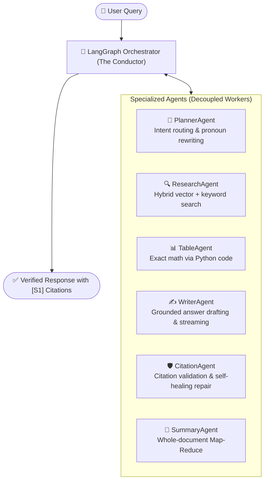
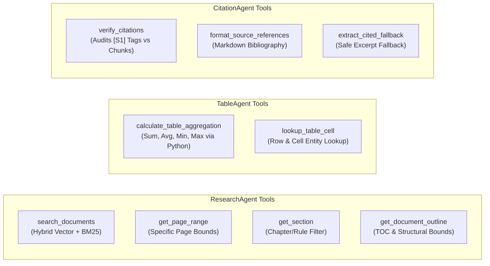
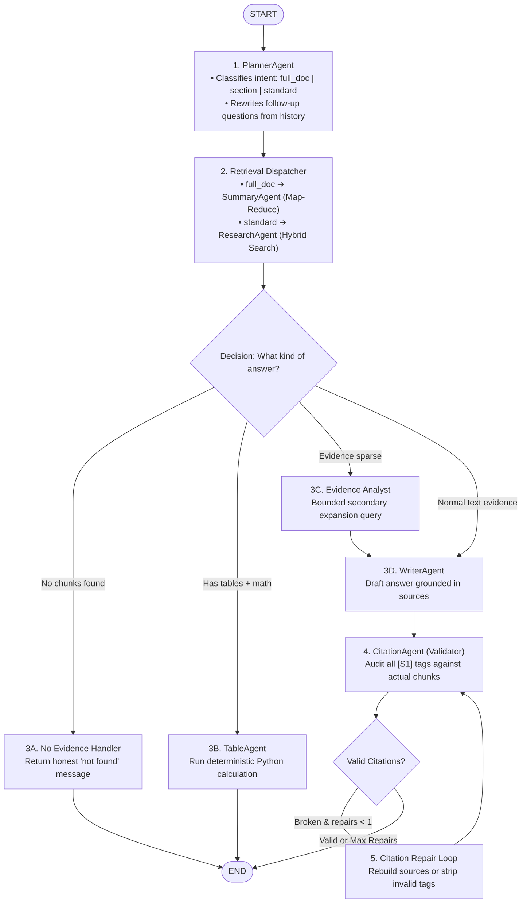
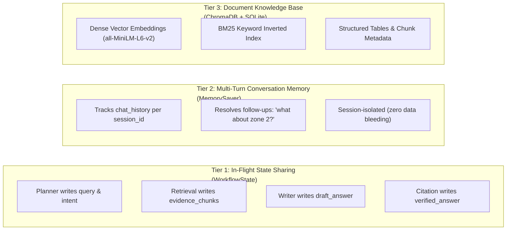

# Multi-Agent RAG System Architecture

A production-grade, supervised multi-agent system designed for grounded question answering and whole-document synthesis over complex documents (PDFs, DOCX, CSVs, TXT).

---

## 1. System Overview & Core Philosophy

Instead of using a single monolithic prompt that attempts to search, calculate, summarize, and draft all at once (which leads to hallucinations and arithmetic errors), the system delegates tasks to **specialized autonomous agents** coordinated by a central **LangGraph Orchestrator**.



### Core Design Principles:
1. **Shared Blackboard Communication**: Agents never message each other directly. All agents read from and write to a single typed dictionary: **`WorkflowState`**.
2. **Deterministic Arithmetic**: Tabular math is executed strictly in Python (0% LLM guesswork).
3. **Strict Source Grounding**: Every factual assertion must link to an explicit citation tag (`[S1]`, `[S2]`) with page-level verification.

---

## 2. Agent Tool Registry & Task Allocations

Each agent is equipped with dedicated tools and routines tailored specifically to its operational domain.



### Detailed Agent & Tool Specifications

| Agent | Tool / Routine | Task & Responsibility |
| :--- | :--- | :--- |
| **`PlannerAgent`** | `plan()` | Analyzes query syntax and intent (`full_doc`, `section`, `standard`). |
| | `reformulate_query()` | Rewrites follow-up pronouns (e.g., *"What about for zone 2?"*) using multi-turn conversation memory. |
| | `plan_with_llm()` | LLM fallback for decomposing complex or ambiguous questions. |
| **`ResearchAgent`** | `search_documents()` | Executes hybrid search (dense embeddings + BM25 keyword rank fusion) with CrossEncoder reranking. |
| | `get_page_range()` | Fetches continuous chunks across specified page boundaries (e.g., Pages 10–25). |
| | `get_section()` | Retrieves chunks matching a specific chapter, section, or rule identifier. |
| | `get_document_outline()` | Retrieves structural table of contents, detected headings, and page boundaries. |
| | `EvidenceSufficiencyAnalyst` | Self-reflective audit that evaluates evidence quality and generates secondary expansion queries if results are sparse. |
| **`SummaryAgent`** | `gather_full_document_evidence()` | Orchestrates Section-Aware Hierarchical Map-Reduce across 100% of chunks. |
| | `partition_chunks()` | Groups large documents into 3–4 macro volume clusters ordered by page number. |
| | `map_cluster_summary()` | Map phase: distills each volume cluster into a structured milestone digest. |
| | `reduce_summaries()` | Reduce phase: synthesizes volume digests into a unified 5-part Executive Briefing. |
| **`TableAgent`** | `calculate_table_aggregation()` | Performs exact Decimal/Fraction math (sum, average, count, min, max) on markdown tables. |
| | `lookup_table_cell()` | Extracts exact cell values matching entity rows without LLM arithmetic. |
| **`WriterAgent`** | `build_context_and_evidence()` | Structures retrieved evidence chunks into labeled `[S1]`, `[S2]` prompts with page metadata. |
| | `build_messages()` | Enforces strict grounding rules preventing hallucinations. |
| | `write_answer_stream()` | Streams generated tokens directly to the user interface in real time. |
| **`CitationAgent`** | `verify_citations()` | Validates that every citation tag in the draft accurately maps to a retrieved source chunk. |
| | `repair_citations()` | Bounded self-healing loop: prompts the model to regenerate text if citations are missing or hallucinated. |
| | `format_source_references()` | Formats the final Markdown bibliography listing file names and page numbers. |
| | `extract_cited_fallback()` | Safe fallback mechanism extracting direct grounded excerpts if synthesis repeatedly fails audit. |

---

## 3. How Orchestration Works (The Execution Pipeline)

The multi-agent workflow is managed by a directed state machine built in **LangGraph** ([`src/orchestration/graph.py`](file:///c:/Users/kartik/Desktop/rag_chatbot_multiagent/src/orchestration/graph.py)):



---

## 4. State Sharing vs. Memory Sharing (The 3 Tiers)

To keep the system organized, state is separated into **three distinct tiers**:



### Tier 1: In-Flight State Sharing (`WorkflowState`)
Within a single query execution, all agents read from and mutate a shared dictionary defined in [`src/agents/contracts.py`](file:///c:/Users/kartik/Desktop/rag_chatbot_multiagent/src/agents/contracts.py):

| State Key | Written By | Read By | Purpose |
| :--- | :--- | :--- | :--- |
| `query` | Input / UI | Planner, Research | Raw question asked by user. |
| `planner_intent` | `PlannerAgent` | Retrieval Dispatcher | Identifies `"full_doc"`, `"section"`, or `"standard"`. |
| `retrieval_query` | `PlannerAgent` | `ResearchAgent` | Cleaned / reformulated search query. |
| `evidence_chunks` | `ResearchAgent` / `SummaryAgent` | Writer, Table, Citation | Discrete chunks with text, page numbers, and table data. |
| `context_text` | `WriterAgent` | LLM Prompts | Labeled `[S1]`, `[S2]` prompt context. |
| `table_answer` | `TableAgent` | Orchestrator Router | Deterministic Python calculation result. |
| `draft_answer` | `WriterAgent` | `CitationAgent` | Initial generated response. |
| `verified_answer` | `CitationAgent` | Output / UI | Final audited answer with verified source tags. |
| `repair_count` | `CitationAgent` | Orchestrator Router | Bounded iteration counter (capped at 1). |
| `trace_steps` | All Nodes | Telemetry / UI | Ordered audit trail: `["planner", "retrieval", ...]`. |

### Tier 2: Multi-Turn Conversation Memory (`MemorySaver`)
- Handled at the graph level using LangGraph's **`checkpointer = MemorySaver()`**.
- Uses `session_id` as the thread configuration key (`{"configurable": {"thread_id": session_id}}`).
- When a user asks: *"What are the water tank rules?"* followed by *"What about vehicular load on it?"*, `PlannerAgent` accesses `chat_history` from the state to reformulate the query into *"What is the vehicular load on the fire water tank covering slab?"*.
- **Strict Isolation**: Sessions do not bleed state, filters, or cached results between different users.

### Tier 3: Persistent Document Knowledge (ChromaDB + SQLite)
- Permanent on-disk storage of document text, dense vector embeddings (`all-MiniLM-L6-v2`), and sparse BM25 indices.
- Supports scoped filtering by `filename`, `page_number`, or document sections.

---

## 5. Whole-Document Summarization (Hierarchical Map-Reduce)

Traditional top-K semantic search fails on 100–400+ page documents because it only retrieves 5–10 chunks. The system utilizes **Section-Aware Hierarchical Map-Reduce**:


### Key Advantages:
1. **100% Chunk Coverage**: Ingests every page and section of the document without arbitrary limits.
2. **Quota Protection**: Clustered into 3–4 macro volumes to comfortably operate within Google Gemini's 15 Requests-Per-Minute rate limit.
3. **Automatic Failover**: If the primary LLM triggers a 429 quota exhaustion, a 60-second cooldown router automatically fails over to Groq.

---

## 6. Directory Structure

```
rag_chatbot_multiagent/
├── src/
│   ├── agents/
│   │   ├── contracts.py           # Typed contracts: WorkflowState, EvidenceChunk, PlannerOutput
│   │   ├── planner_agent.py       # Intent router (full_doc | section | standard) & query reformulator
│   │   ├── research_agent.py      # Autonomous retrieval & EvidenceSufficiencyAnalyst
│   │   ├── summary_agent.py       # Hierarchical Map-Reduce document summarizer
│   │   ├── table_agent.py         # Tabular data parser & deterministic math calculator
│   │   ├── writer_agent.py        # Grounded answer drafting & real-time token streaming
│   │   ├── citation_agent.py      # Citation verification & self-healing repair
│   │   └── tools/                 # Decoupled agent tool definitions
│   │       ├── research_tools.py  # search_documents, get_page_range, get_section
│   │       ├── table_tools.py     # calculate_table_aggregation, lookup_table_cell
│   │       └── citation_tools.py  # verify_citations, format_source_references
│   ├── orchestration/
│   │   └── graph.py               # LangGraph StateGraph, conditional edges, MemorySaver checkpointer
│   ├── retrieval/
│   │   ├── chroma_vectorstore.py  # Dense vector collection management
│   │   ├── hybrid_search.py       # BM25 + Dense reciprocal rank fusion + CrossEncoder reranker
│   │   ├── data_loader.py         # Multi-format parsing (PDF, DOCX, CSV, TXT)
│   │   └── embeddings.py          # Embedding model loaders
│   ├── services/
│   │   ├── table_service.py       # Pandas / Python tabular computation engine
│   │   └── citation_service.py    # Source tag parsing, normalization, and validation
│   ├── chat_service.py            # Session management, streaming generator, 429 cooldown router
│   └── rag_pipeline.py            # High-level clean facade connecting UI to the graph
├── tests/                         # Full automated test suite (Pytest)
├── app.py                         # Streamlit UI
└── architecture_plan.md           # Authoritative system architecture specification
```
