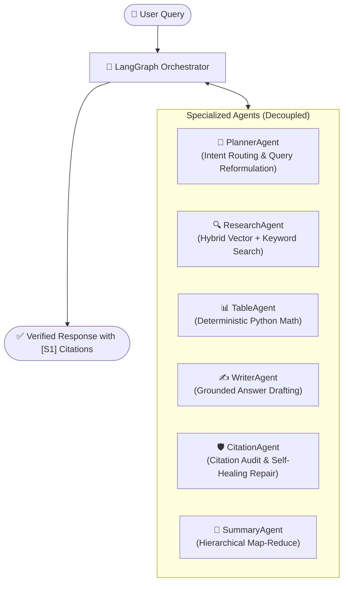
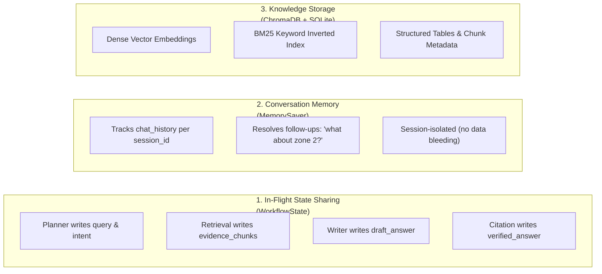
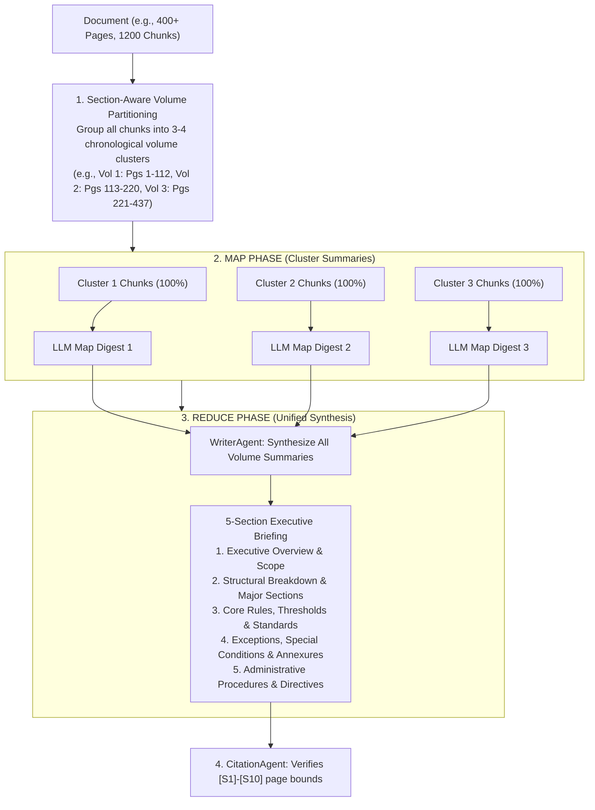

# Multi-Agent RAG System Architecture & Functional Design

A production-grade, supervised multi-agent system designed for grounded question answering and whole-document synthesis over complex documents (PDFs, DOCX, CSVs, TXT).

---

## 1. Is the Architecture Plan the Same as the Functional System?

**Yes, the foundational architecture is identical, with two key real-world improvements in the functional system:**

| Component | Initial Architecture Plan | Real-World Functional System | Why It Was Improved |
| :--- | :--- | :--- | :--- |
| **Agent Roles** | 5 core agents (`Planner`, `Research`, `Table`, `Writer`, `Citation`) | 5 core agents + `EvidenceSufficiencyAnalyst` | Adds self-reflective evaluation to expand search if initial evidence is sparse. |
| **Document Summarization** | Milestone Sampling (Head + Middle + Tail chunks) | **Hierarchical Map-Reduce** (Volume Clustering $\rightarrow$ Map $\rightarrow$ Reduce) | Milestone sampling missed internal chapters in 400+ page legal documents. Map-Reduce digests 100% of chunks across all sections. |
| **Orchestration** | LangGraph StateGraph | LangGraph StateGraph with `MemorySaver` checkpointer | Stateful multi-turn chat persistence per `session_id`. |
| **State Sharing** | Shared blackboard state | `WorkflowState` (`TypedDict`) | Strict contract decoupling agents from each other. |

---

## 2. High-Level Architecture Overview

Instead of one monolithic LLM prompt that tries to do everything (and hallucinates), the system divides the workload into **specialized autonomous agents** coordinated by a central **LangGraph Orchestrator**.



### The Core Principles:
1. **Agents Never Talk Directly to Each Other**: Every agent communicates exclusively by reading from and writing to the shared **`WorkflowState`** blackboard.
2. **Zero Math Guessing**: Tabular calculations are executed using deterministic Python code (`TableAgent`), never LLM arithmetic.
3. **Mandatory Source Grounding**: Every factual claim is validated against retrieved source chunks with explicit citation tags (`[S1]`, `[S2]`).

---

## 3. How Orchestration Works (The Execution Pipeline)

The workflow is governed by a directed state machine built with **LangGraph**:


---

## 4. State Sharing vs. Memory Sharing

A critical architectural distinction is how information is shared **within a turn** vs. **across turns** vs. **permanently**.



### Tier 1: In-Flight State Sharing (`WorkflowState`)
Within a single user prompt, all agents read and mutate a shared dictionary defined in [`src/agents/contracts.py`](file:///c:/Users/kartik/Desktop/rag_chatbot_multiagent/src/agents/contracts.py):

| State Key | Owned / Written By | Read By | Purpose |
| :--- | :--- | :--- | :--- |
| `query` | Input / UI | Planner, Research | Raw question asked by user. |
| `planner_intent` | `PlannerAgent` | Retrieval Dispatcher | Identifies `"full_doc"`, `"section"`, or `"standard"`. |
| `retrieval_query` | `PlannerAgent` | `ResearchAgent` | Optimized search string (resolved from pronouns). |
| `evidence_chunks` | `ResearchAgent` / `SummaryAgent` | Writer, Table, Citation | Discrete chunks `[S1]`, `[S2]` with page & file metadata. |
| `context_text` | `WriterAgent` | LLM Prompts | Clean string representation of chunks passed to prompt. |
| `table_answer` | `TableAgent` | Orchestrator | Exact math computation output. |
| `draft_answer` | `WriterAgent` | `CitationAgent` | Initial drafted text. |
| `verified_answer` | `CitationAgent` | Output / UI | Final validated text with strict citation integrity. |
| `repair_count` | `CitationAgent` | Orchestrator Router | Guard against infinite repair loops (capped at 1). |
| `trace_steps` | All Nodes | Debug / Observability | Ordered list of visited nodes `["planner", "retrieval", ...]`. |

### Tier 2: Multi-Turn Conversation Memory (`MemorySaver`)
- Handled at the graph level via LangGraph's **`checkpointer = MemorySaver()`**.
- Uses `session_id` as the thread configuration key (`{"configurable": {"thread_id": session_id}}`).
- When a user asks: *"What was the rule mentioned in section 3?"* followed by *"Does that apply to residential buildings?"*, `PlannerAgent` accesses `chat_history` from the state to reformulate the query into *"Does Section 3 building rule apply to residential buildings?"*.
- **Strict Isolation**: Sessions do not bleed state, filters, or cached results between users.

### Tier 3: Persistent Document Memory (ChromaDB + BM25)
- Chunk storage with dense vector embeddings (`all-MiniLM-L6-v2`) and sparse BM25 indices.
- Supports scoped filtering by `filename`, `page_number`, or document section.

---

## 5. How Summarization Works: Hierarchical Map-Reduce

For documents ranging from 10 to 400+ pages, traditional top-K semantic search fails because it only grabs the top 5–10 chunks. The functional system employs **Section-Aware Hierarchical Map-Reduce**:



### Key Advantages of this Approach:
1. **100% Document Coverage**: No pages or chapters are skipped.
2. **Quota-Aware**: Grouping into 3–4 macro clusters guarantees execution remains well within Gemini's 15 Requests-Per-Minute free tier limit.
3. **Failover Safety**: If primary LLM hits rate limits (HTTP 429), the orchestrator automatically triggers a 60-second cooldown router to seamlessly fail over to Groq.

---

## 6. Directory Layout (Functional Codebase)

```
rag_chatbot_multiagent/
├── src/
│   ├── agents/
│   │   ├── contracts.py           # Typed contracts: WorkflowState, EvidenceChunk, PlannerOutput
│   │   ├── planner_agent.py       # Intent router (full_doc | section | standard) + Query reformulator
│   │   ├── research_agent.py      # Autonomous retrieval + EvidenceSufficiencyAnalyst
│   │   ├── summary_agent.py       # Hierarchical Map-Reduce document summarizer
│   │   ├── table_agent.py         # Tabular data parser & deterministic math calculator
│   │   ├── writer_agent.py        # Grounded answer drafting & real-time streaming
│   │   ├── citation_agent.py      # Citation verification & self-healing repair
│   │   └── tools/                 # Decoupled agent tool definitions
│   │       ├── research_tools.py
│   │       ├── table_tools.py
│   │       └── citation_tools.py
│   ├── orchestration/
│   │   └── graph.py               # LangGraph StateGraph, conditional edges, MemorySaver checkpointer
│   ├── retrieval/
│   │   ├── chroma_vectorstore.py  # Dense vector collection management
│   │   ├── hybrid_search.py       # BM25 + Dense reciprocal rank fusion + CrossEncoder reranker
│   │   ├── data_loader.py         # Multi-format parsing (PDF, DOCX, CSV, TXT)
│   │   └── embeddings.py          # Embedding model loaders
│   ├── services/
│   │   ├── table_service.py       # Pandas / Python tabular computation engine
│   │   └── citation_service.py    # Source tag parsing, normalization, and validation
│   ├── chat_service.py            # Session management, streaming generator, 429 cooldown router
│   └── rag_pipeline.py            # High-level clean facade connecting UI to the graph
├── tests/                         # Full automated test suite (Pytest)
├── app.py                         # Streamlit UI
└── architecture_plan.md           # This document
```
