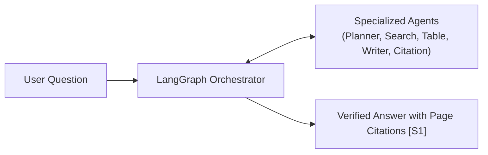
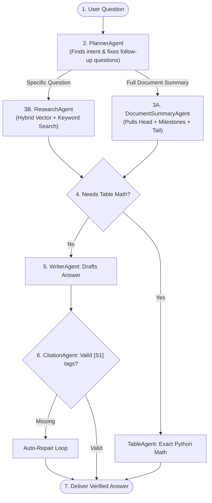
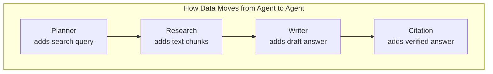
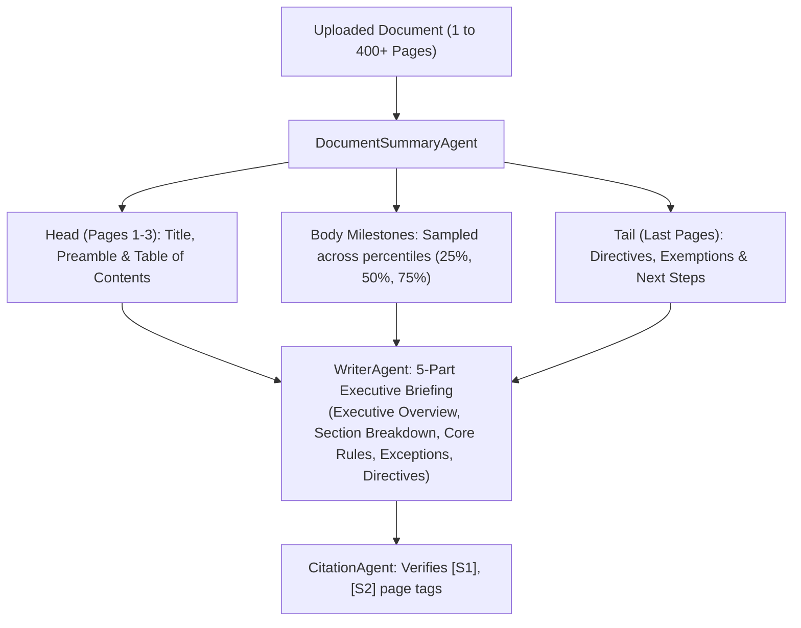

# Multi-Agent RAG System Architecture

A clean, supervised multi-agent system designed for accurate question answering and whole-document summarization over large documents (PDFs, DOCX, CSVs).

---

## 1. Core Idea

Instead of using one big prompt, the system divides the work among **specialized agents** coordinated by **LangGraph**.

- **Shared Blackboard**: Agents do not chat with each other. They read from and write to one shared dictionary (`WorkflowState`).
- **Exact Math**: Tables are calculated with Python math (0% LLM guessing).
- **Verifiable Sources**: Every statement must cite its source (e.g. `[S1]`, `[S2]`).

---

## 2. The Agents & Their Roles

| Agent | What It Does | Tools Used |
| :--- | :--- | :--- |
| **`PlannerAgent`** | Understands user intent and rewrites follow-up questions | LLM planning prompt |
| **`ResearchAgent`** | Finds relevant text and tables across the document | `search_documents`, `get_page_range`, `get_section` |
| **`DocumentSummaryAgent`** | Gathers strategic anchors for whole-document summaries | `get_document_outline`, `query_by_pages` |
| **`TableAgent`** | Performs exact math on markdown tables | `calculate_table_aggregation`, `lookup_table_cell` |
| **`WriterAgent`** | Writes the final grounded answer or executive summary | System prompts + token streamer |
| **`CitationAgent`** | Audits citations (`[S1]`) and fixes any missing references | `verify_citations`, `format_source_references` |

---

## 3. How a Question is Answered (Execution Flow)

---

## 4. How Memory is Shared

Agents share data through a single shared state called **`WorkflowState`**.

### The 3 Memory Levels

1. **Working Memory (`WorkflowState`)**:
   - Temporary dictionary used during a single question.
   - Passes retrieved chunks and draft answers from one agent to the next.

2. **Conversation Memory (`MemorySaver`)**:
   - Remembers past chat turns for the user session.
   - Allows follow-ups like *"What about for zone 2?"* without re-reading the entire file.

3. **Document Storage (ChromaDB + SQLite)**:
   - Permanent storage of document text, embeddings, and tables.

---

## 5. How Whole-Document Summarization Works

Simple RAG fails on 50–400 page PDFs because it only retrieves the first few pages. This system uses **Milestone Sampling**:

- **Fast**: Generates in **one single LLM pass (2–4 seconds)**.
- **Complete**: Covers the beginning, middle, and end of the document.
- **Accurate**: Every claim links to an exact page number citation.

